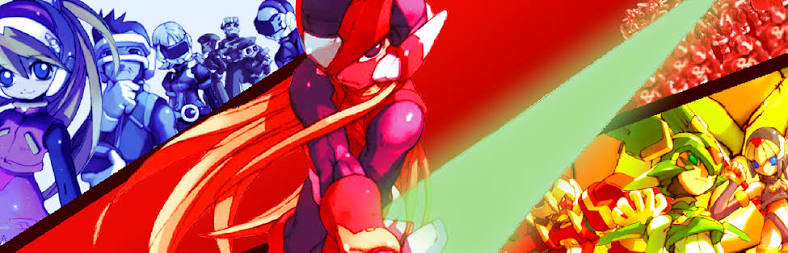

# Mega Man Zero 1–4 — Native Recompilation



Native (static-recomp) ports of **Mega Man Zero 1–4** for PC, built with [`gbarecomp`](https://github.com/mstan/gbarecomp) and [`recomp-ui`](https://github.com/mstan/recomp-ui).

Each game is individually recompiled from its GBA ROM into a standalone Windows executable with an integrated Dear ImGui launcher (settings, controls, mod support). A multi-game launcher lets you switch between titles without leaving the UI.

---

## 🎮 Games

| Game | ROM ID | Save Type | Status |
|------|--------|-----------|--------|
| Mega Man Zero | A62E | SRAM 32KB | Playable |
| Mega Man Zero 2 | A62E | SRAM 32KB | Playable (bring-up in progress) |
| Mega Man Zero 3 | BZ3E | SRAM 32KB | Playable (bring-up in progress) |
| Mega Man Zero 4 | B4ZE | EEPROM 8KB | Playable (bring-up in progress) |

---

## ✨ Features

- **Per-game native executables** (MMZ1–MMZ4) with integrated recomp-ui launcher
- **Multi-game launcher** (`MegaManZeroLauncher.exe`) to switch between titles
- **In-launcher game switching** via `Juegos` button in recomp-ui Dashboard
- **Configurable controls** (keyboard + gamepad) saved per-game via `keybinds.ini`
- **Settings**: video (raw/CRT), audio, display, fullscreen, widescreen
- **Mod support** via `.gbamod` packages
- **Discovery-based bring-up** workflow for static recompilation corpus
- **Per-game box art** and assets

---

## 📋 Requirements

- **CMake** 3.20+
- **Ninja**
- **GCC/G++** (MinGW on Windows)
- **SDL2** (included in `deps/`)
- **Python 3** (for tools)
- **ROMs** (not included — you must provide your own legally obtained copies)
- **GBA BIOS** (not included)

---

## 🔧 Building

### 1. Prerequisites

Place your ROMs and BIOS:
```
games/mmz2-recomp/roms/megaman_zero_2_usa.gba
games/mmz3-recomp/roms/megaman_zero_3_usa.gba
games/mmz4-recomp/roms/megaman_zero_4_usa.gba
gbarecomp/bios/gba_bios.bin
MegaManZeroRecomp/gbarecomp/bios/gba_bios.bin   (junction or copy)
```

Ensure `MegaManZeroRecomp/gbarecomp` and `MegaManZeroRecomp/recomp-ui` are present (they may be junctioned to a shared checkout).

### 2. Configure and build a game

```bash
cd games/mmz2-recomp
cmake -S . -B build
cmake --build build --target MegaManZero2Recomp -j 4
```

### 3. Regenerate code (after editing game.toml)

```bash
cd games/mmz2-recomp
powershell -File tools/regen.ps1 -GbarecompRoot ../../MegaManZeroRecomp/gbarecomp
```

### 4. Build all games

```bash
cmake --build games/mmz2-recomp/build --target MegaManZero2Recomp -j 4
cmake --build games/mmz3-recomp/build --target MegaManZero3Recomp -j 4
cmake --build games/mmz4-recomp/build --target MegaManZero4Recomp -j 4
cmake --build MegaManZeroRecomp/build --target MegaManZeroRecomp -j 4
```

---

## 🚀 Launcher

### Integrated (recomp-ui)
Each game includes an integrated launcher (recomp-ui) with:
- **Juegos** button → switch between MMZ1–MMZ4 launchers
- **Settings** → video, audio, display, fullscreen
- **Controller** → keyboard and gamepad rebinds
- **Mods** → mod catalog management

### External
`MegaManZeroLauncher.exe` — standalone multi-game selector (WinForms/PowerShell).

---

## 🎮 Controls (default)

| Action | Key |
|--------|-----|
| D-Pad | Arrow keys |
| A | X |
| B | Z |
| L | C |
| R | V |
| Start | Return/Enter |
| Select | Right Shift |

Controls are saved per-game in `build/keybinds.ini` (`[player1]` section). Use the **Controller** tab in the launcher to rebind, or **Copiar controles actuales a los otros juegos** to sync across titles.

---

## 🗂️ Project Structure

```
├── MegaManZeroRecomp/       # MMZ1 (reference build)
│   ├── src/main.cpp
│   ├── recomp/launcher/     # Box art, assets
│   └── build/               # Build output
├── games/
│   ├── mmz2-recomp/         # MMZ2
│   ├── mmz3-recomp/         # MMZ3
│   └── mmz4-recomp/         # MMZ4
├── gbarecomp/               # Shared gbarecomp engine (junction)
├── recomp-ui/               # Shared recomp-ui launcher (junction)
├── deps/SDL2-2.32.10/       # SDL2 dependency
├── launcher/                # External launcher (PowerShell/WinForms)
├── MegaManZeroLauncher.exe  # External launcher executable
├── .gitignore
└── README.md
```

---

## 🔍 Bring-up Workflow

Each game uses a discovery-based approach for static recompilation:

1. **Discovery session**: Run `tools/play-discovery.ps1` (headless or interactive)
2. **Review**: Check `build/discovery_sessions/<timestamp>/misses.toml.frag`
3. **Integrate**: Merge `extra_func`, `code_copy`, `jump_table` entries into `game.toml`
4. **Regenerate**: Run `tools/regen.ps1`
5. **Rebuild**: `cmake --build build --target MegaManZeroXRecomp`

---

## 📝 Notes

- **ROMs and BIOS are NOT included.** Provide your own legally obtained copies.
- Save types: MMZ2/MMZ3 = SRAM 32KB, MMZ4 = EEPROM 8KB (8192 bytes).
- `screen = "raw"` in `game.toml` disables color correction (MMZ2).
- IWRAM code copy for MMZ2: 896 bytes from `0x080ECF10` → `0x03000000`.
- BIOS addresses `0x00000018` and `0x00000138` are ARM routines (handled by BIOS config).

---

## 🙏 Credits

- **mstan** — Creator of [`gbarecomp`](https://github.com/mstan/gbarecomp), [`recomp-ui`](https://github.com/mstan/recomp-ui), and the original Mega Man Zero recompilation project. This project builds upon his work and tools.
- **Capcom** — Mega Man Zero series.
- **SDL2** — Simple DirectMedia Layer (zlib license).

## 📄 License

This project is for educational/research purposes. Mega Man Zero is a trademark of Capcom. ROMs and BIOS are not included and must be obtained legally. Code in `gbarecomp` and `recomp-ui` is subject to their respective licenses.